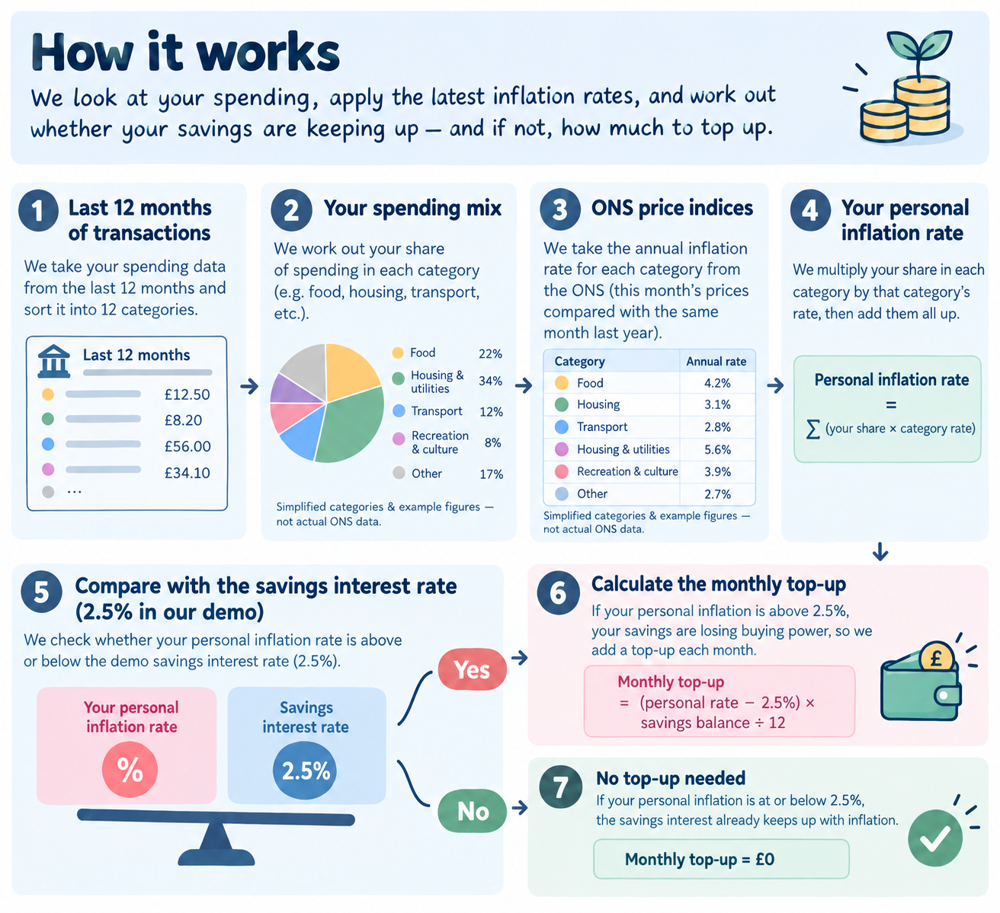
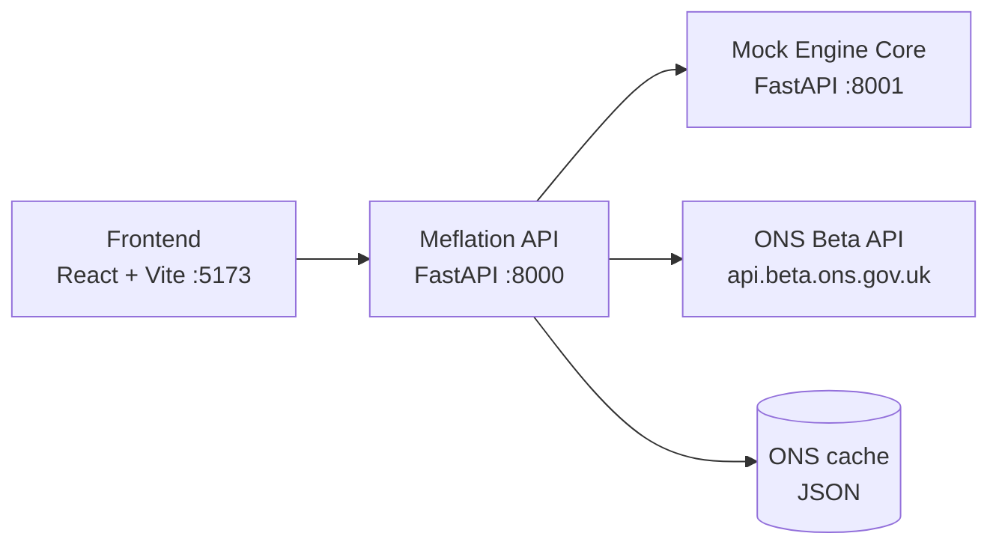

# Meflation 📈

**The inflation rate that's actually about you.**

Built at #HuddleHiveHack26 for the Starling Engine challenge: *Banking-as-a-Platform: The Marketplace Mashup*.

---

## The problem

The inflation figure on the news is an average across the whole country. Your real inflation rate depends on what *you* spend money on. A student renting in London and a commuter who drives can feel very different price rises in the same month.

Your savings lose value at *your* rate, and no bank tells you what that is.

## What Meflation does

- **Calculates your personal inflation rate** from your real card transactions, using official ONS price data.
- **Shows you what's driving it**, so you can see that, say, food and rent are pushing you above the headline rate.
- **Tracks you against the headline** month by month.
- **Inflation-proofs your savings** with one tap, by setting up a monthly top-up into a Space so your savings keep their real value.

## The mashup

| Banking side | Non-banking side |
|---|---|
| Mock Engine Core: accounts, transactions, Spaces, standing orders | ONS Beta API: official UK price index data by spending category |

---

## How it works



1. Pull transactions from Engine.
2. Map each transaction to one of the 12 official ONS spending categories (COICOP divisions), using its merchant category code (MCC), then merchant-name rules as a fallback.
3. Work out the share of spending in each category over the last 12 months. These are your **personal weights**.
4. Get each category's annual inflation rate from ONS.
5. Calculate your rate:

```
personal_rate = Σ (your_weight_in_category × category_inflation_rate)
```

6. Inflation-proof top-up each month:

```
monthly_top_up = savings_balance × (personal_rate − savings_interest_rate) / 12
```

The top-up covers the gap between your personal inflation and what the savings pot already earns, spread over 12 months. It is never below zero: if the savings rate beats your inflation, no top-up is needed.

ONS returns index levels, so annual rates are calculated as:

```
annual_rate = index_this_month / index_same_month_last_year − 1
```

### Worked example

Three people, each with £5,000 in their savings Space, and a savings interest rate of 2.5%:

| Person | Spending mix | Personal rate | Gap over savings rate | Monthly top-up |
|---|---|---|---|---|
| A | Heavy on rent and energy | 5.0% | 2.5% | £5,000 × 0.025 / 12 ≈ **£10.42** |
| B | Mostly groceries and transport | 3.5% | 1.0% | £5,000 × 0.010 / 12 ≈ **£4.17** |
| C | Spending close to the average | 2.0% | below zero | **£0** (savings already outpace their inflation) |

Only the *proportions* of spending matter, not the amounts: two people with the same spending mix get the same personal rate, however much they spend. The savings balance matters too, because a bigger pot needs a bigger top-up to keep the same buying power.

When the "inflation-proof" toggle is switched on, the app creates the savings Space (if there isn't one) and a monthly standing order for the top-up amount through Engine. "Simulate next month" runs it and the balance goes up. Switching the toggle off deletes the standing order.

The history chart shows 12 monthly points, each using the 12 months of spending before it. That's why the demo personas have **24 months** of transactions.

## Architecture



The Engine mock runs as its own service on a separate port, so Meflation genuinely connects to "Engine" over HTTP, the same way a real third-party integration would. The frontend only talks to the Meflation API.

---

## Team

Everyone owns a slice of the backend **and** the frontend components that display it.

| Who | Owns | Backend | Frontend |
|---|---|---|---|
| Person 1 _(name)_ | Mock Engine Core | `engine-mock/app/`, `seed/load.py`, `backend/app/engine_client.py`, `routes/bank.py` | `SpacesPanel` |
| Person 2 _(name)_ | Data and categorisation | `seed/generate_personas.py` + JSON, `backend/app/categorise/`, `routes/statements.py` | `PersonaSwitcher`, `UploadStatement`, `CategorisedBadge` |
| Person 3 _(name)_ | ONS pipeline and app shell | `backend/app/ons/`, `routes/inflation.py`, `main.py`, `config.py` | `App.jsx`, `styles.css`, `api.js`, `SourceFooter`, headline line on `HistoryChart` |
| Person 4 _(name)_ | Calculation engine | `backend/app/calc/`, `routes/personal.py`, `routes/inflation_proof.py` | `HeadlineCard`, `BreakdownChart`, `InflationProofToggle`, personal line on `HistoryChart` |

Every file starts with a comment saying who owns it, and every unfinished piece is marked `TODO(Person N)`. To see your list:

```bash
grep -rn "TODO(Person 2)" --include=*.py --include=*.jsx --include=*.js .
```

Shared files (`schemas.py`, `divisions.py`, `config.py`, `api.js`, `docs/contracts.md`): change them freely, but tell the team.

## Folder structure

```
meflation/
├── README.md
├── .gitignore
├── docs/
│   └── contracts.md                  # every JSON shape, agree in the first hour
├── scripts/
│   └── dev.sh                        # sets up and starts all three services
├── pitch/
│   └── demo-script.md
│
├── engine-mock/                      # Mock Engine Core (port 8001)
│   ├── requirements.txt              # includes sqlmodel + sqlalchemy
│   ├── pytest.ini
│   ├── app/
│   │   ├── main.py                   # P1
│   │   ├── db.py                     # P1  SQLite setup
│   │   ├── models.py                 # P1  Account, Transaction, Space, StandingOrder
│   │   ├── schemas.py                # P1  request bodies
│   │   └── routes/                   # P1
│   │       ├── accounts.py
│   │       ├── transactions.py
│   │       ├── spaces.py
│   │       ├── standing_orders.py
│   │       ├── simulate.py           # "simulate next month" for the demo
│   │       └── admin.py              # /admin/reset before every rehearsal
│   ├── seed/
│   │   ├── personas.json             # P2  4 personas, monthly budgets
│   │   ├── merchants.json            # P2  real UK merchants + MCCs
│   │   ├── generate_personas.py      # P2  writes generated/transactions.json
│   │   ├── load.py                   # P1  loads it into the database
│   │   └── generated/
│   └── tests/
│       └── test_health.py
│
├── backend/                          # Meflation API (port 8000)
│   ├── requirements.txt              # includes openai (Azure OpenAI client)
│   ├── pytest.ini                    # registers the "integration" marker
│   ├── .env.example
│   ├── app/
│   │   ├── main.py                   # P3  wires up the routers
│   │   ├── config.py                 # P3  settings from .env
│   │   ├── schemas.py                # shared: contracts as code
│   │   ├── divisions.py              # shared: the 12 categories
│   │   ├── engine_client.py          # P1  the only code that calls Engine
│   │   ├── services/
│   │   │   └── openai.py             # Azure OpenAI client
│   │   ├── categorise/               # P2
│   │   │   ├── mcc_map.py
│   │   │   ├── keywords.py
│   │   │   ├── llm.py                # fallback for unmapped merchants (needs Azure key), caches answers
│   │   │   ├── llm_cache.json        # merchants already classified (generated)
│   │   │   ├── categorise.py
│   │   │   └── csv_import.py
│   │   ├── ons/                      # P3
│   │   │   ├── codes.py              # our codes -> ONS aggregate codes
│   │   │   ├── fetch.py
│   │   │   ├── rates.py
│   │   │   ├── cache.py
│   │   │   ├── service.py            # what everyone else calls
│   │   │   ├── refresh.py            # python -m app.ons.refresh
│   │   │   └── cache/                # ons_cache.json goes here (commit it)
│   │   ├── calc/                     # P4
│   │   │   ├── weights.py
│   │   │   ├── personal_rate.py
│   │   │   ├── history.py
│   │   │   ├── top_up.py
│   │   │   └── explain.py
│   │   └── routes/
│   │       ├── bank.py               # P1
│   │       ├── statements.py         # P2
│   │       ├── inflation.py          # P3
│   │       ├── personal.py           # P4
│   │       └── inflation_proof.py    # P4
│   └── tests/
│       ├── test_health.py
│       ├── test_categorise.py        # P2
│       ├── test_llm.py               # P2  mocked tests + real-API integration tests
│       ├── test_rates.py             # P3
│       └── test_calc.py              # P4
│
└── frontend/                         # React + Vite (port 5173)
    ├── package.json
    ├── vite.config.js
    ├── index.html
    ├── .env.example
    └── src/
        ├── main.jsx
        ├── App.jsx                   # P3  page layout
        ├── styles.css                # P3  shared colours and layout
        ├── api.js                    # shared: mock/real switch
        ├── mock/                     # fake JSON until the backend is ready
        └── components/
            ├── HeadlineCard.jsx          # P4
            ├── BreakdownChart.jsx        # P4
            ├── HistoryChart.jsx          # P3 + P4
            ├── InflationProofToggle.jsx  # P4
            ├── SpacesPanel.jsx           # P1
            ├── PersonaSwitcher.jsx       # P2
            ├── UploadStatement.jsx       # P2
            ├── CategorisedBadge.jsx      # P2
            └── SourceFooter.jsx          # P3
```

---

## Getting started

From the repo root in three PowerShell terminals:

Run .venv\Scripts\Activate.ps1; cd engine-mock; uvicorn app.main:app --reload --port 8001.
Run .venv\Scripts\Activate.ps1; cd backend; uvicorn app.main:app --reload --port 8000.
Run cd frontend; npm run dev.
Then open http://localhost:5173.

### Prerequisites

- Python 3.11 to 3.13 (3.14 is very new and some packages don't have prebuilt versions for it yet)
- Node 20.19+ (Vite needs it)

### Engine mock

```bash
cd engine-mock
python -m venv .venv && source .venv/bin/activate
pip install -r requirements.txt
python -m seed.generate_personas   # once Person 2's generator works
python -m seed.load                # once Person 1's loader works
uvicorn app.main:app --reload --reload-dir app --port 8001
```

Docs at http://localhost:8001/docs

### Meflation API

```bash
cd backend
python -m venv .venv && source .venv/bin/activate
pip install -r requirements.txt
cp .env.example .env
uvicorn app.main:app --reload --reload-dir app --port 8000
```

Docs at http://localhost:8000/docs

`--reload-dir app` makes uvicorn watch only your code. Without it, it watches `.venv` too and restarts constantly whenever pip or a sync tool touches a file in there. Changes to `.env` aren't picked up by the reloader, so restart the server after editing it.

### Frontend

```bash
cd frontend
npm install
cp .env.example .env               # VITE_USE_MOCK=true until Day 1 evening
npm run dev
```

Open http://localhost:5173

### Everything at once

Run `./scripts/dev.sh` from the repo root. It creates the venvs, installs the requirements, runs `npm install`, copies any missing `.env` files, then starts all three services.

- `SKIP_INSTALL=1 ./scripts/dev.sh` skips the install step.
- `PYTHON=python3.12 ./scripts/dev.sh` picks the Python version (only applies when a venv is first created).

### Tests

```bash
cd engine-mock && pytest
cd backend && pytest -m "not integration"   # offline, free, fast
cd backend && pytest -m integration         # calls the real Azure OpenAI API (needs credentials in .env)
```

Unfinished endpoints return **501 Not Implemented** and placeholder tests are skipped, so everything runs from the start. The integration tests skip themselves if no Azure key is set.

---

## Configuration (`backend/.env`)

| Variable | Default | What it does |
|---|---|---|
| `ENGINE_URL` | `http://localhost:8001` | Where the mock Engine runs |
| `OFFLINE` | `false` | `true` = never call ONS, read `ons/cache/ons_cache.json` only |
| `USE_LLM` | `true` | Use the LLM to categorise merchants the MCC and keyword rules miss |
| `AZURE_OPENAI_API_KEY` | empty | Needed for the LLM fallback. With no key, the LLM stays off |
| `AZURE_OPENAI_ENDPOINT` | empty | Your Azure OpenAI endpoint |
| `AZURE_OPENAI_DEPLOYMENT` | `gpt-4o-mini` | The model deployment name in Azure |
| `SAVINGS_INTEREST_RATE` | `0.025` | Interest the savings Space earns, as a decimal (0.025 = 2.5%). Used in the top-up formula |

**Savings interest rate.** We use 2.5%, the standard Starling Easy Saver rate (AER) *without* any introductory bonus. Starling currently advertises 5.00% AER to new customers, but that includes a fixed 2.50% bonus for the first 6 months only (and up to £25k), after which the account drops to the 2.50% standard rate. The top-up is a long-run monthly payment, so the standard rate is the honest one to use. It also keeps the demo meaningful: against a 4 to 5% savings rate, most personas would need no top-up at all. Rates change often, so check [starlingbank.com/savings](https://www.starlingbank.com/savings/) before the pitch and update the value if the standard rate has moved. Source and date: Starling Easy Saver page, checked 2026-10-10.

The LLM only runs when `USE_LLM` is true **and** an Azure key is set. It sends merchant names only (no amounts or dates), in one batched request, and saves the answers in `categorise/llm_cache.json` so the same merchant is never asked about twice. Set `USE_LLM=false` for the demo if you want it fully off.

Never commit `.env`. To refresh the ONS cache, run `python -m app.ons.refresh` from `backend/`.

---

## API contracts

All JSON shapes are in [`docs/contracts.md`](docs/contracts.md). Agree them in the first hour. **Don't change them without telling the team.**

Rules everyone follows:
- Money is whole pence (negative = money out).
- Rates are decimals (0.045 = 4.5%).
- Division codes are `"01"` to `"12"`.

## ONS data

- **Base URL:** `https://api.beta.ons.gov.uk/v1`
- **Dataset:** `cpih01`
- **Geography:** `K02000001` (UK)
- **Latest version:** read `links.latest_version.id` from `GET /datasets/cpih01` (don't hardcode it)
- **Time labels:** `Mon-YY` (e.g. `Oct-11`), converted to `YYYY-MM` by `parse_ons_month`
- **Aggregate codes:** the overall index is `CP00`, and our divisions `"01"` to `"12"` map to `CP01` to `CP12`. They're recorded in `backend/app/ons/codes.py`. To list or recheck them:

```
GET /datasets/cpih01/editions/time-series/versions/{version}/dimensions/aggregate/options?limit=200
```

Example (one month of the overall index):

```
GET /datasets/cpih01/editions/time-series/versions/{version}/observations?time=Jan-26&geography=K02000001&aggregate=CP00
```

> **Data freshness:** ONS has marked this dataset as no longer updated. The latest month available is **January 2026**, so the app's "latest month" and the footer reflect that. The demo reads from the committed cache (`OFFLINE=true`) so it doesn't depend on the API being up.

## MCC to spending category (starter mapping)

| MCC | Merchant type | ONS division |
|---|---|---|
| 5411 | Grocery stores | 01 Food and non-alcoholic beverages |
| 5921 | Off-licences | 02 Alcohol and tobacco |
| 5651 | Clothing | 03 Clothing and footwear |
| 4900 | Utilities | 04 Housing, water, electricity, gas |
| 5912 | Pharmacies | 06 Health |
| 4111, 5541 | Commuter transport, fuel | 07 Transport |
| 4814 | Telecoms | 08 Communication |
| 7832 | Cinemas | 09 Recreation and culture |
| 8220 | Universities | 10 Education |
| 5812, 5814 | Restaurants, fast food | 11 Restaurants and hotels |

Transfers, cash withdrawals and incoming payments are excluded and reported in the categorisation summary.

---

## Timeline

| When | Goal |
|---|---|
| Day 1, first hour | Agree contracts, everyone can run their service |
| Day 1, afternoon | Build individual parts against mock data |
| Day 1, evening | Working end to end, even if it's ugly |
| Day 2, morning | Real ONS data, polish, persona tuning |
| Day 2, afternoon | **Code freeze.** Rehearse the demo at least twice |

---

## Limitations

- **It's an estimate.** ONS rates are national averages for each category, not the actual prices you paid. Two people buying "food" can see different price rises depending on where they shop.
- **Category mapping is approximate.** One MCC can cover several kinds of spending (a supermarket also sells clothes), so some spend lands in the wrong category.
- **ONS data stops at January 2026.** ONS no longer updates the CPIH dataset we use, so figures are as of that month.

## What's next

- Use itemised receipts to split mixed baskets into the right categories.
- Regional rates, once ONS publishes them at the right level of detail.
- Nudges when your rate jumps, explaining which category caused it.
- Open it up to other Engine banks as a toggleable capability.
- Move to ONS's published time series tables for data after January 2026.

---

*Built in 48 hours by four people and a lot of M%S Cookies, whose price rose 0.3% while we wrote this README.* ☕