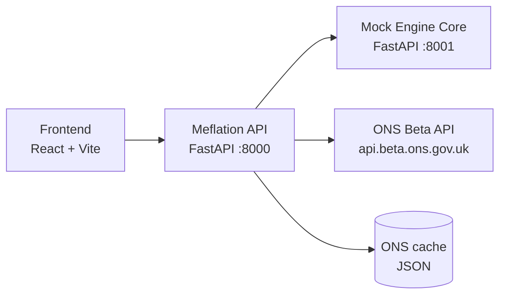

# Meflation 📈

**The inflation rate that's actually about you.**

Built at #HuddleHiveHack26 for the Starling Engine challenge: *Banking-as-a-Platform: The Marketplace Mashup*.

---

## The problem

The inflation figure on the news is an average across the whole country. Your real inflation rate depends on what *you* spend money on. A student renting in London, a commuter who drives and a parent doing a big weekly food shop can all feel very different price rises in the same month.

Your savings lose value at *your* rate, and no bank tells you what that is.

## What Meflation does

- **Calculates your personal inflation rate** from your real card transactions, using official ONS price data.
- **Shows you what's driving it**, so you can see that, say, food and rent are pushing you above the headline rate.
- **Tracks you against the headline** month by month.
- **Inflation-proofs your savings** with one tap, by setting up a monthly top-up into a Space so your savings keep their real value.

## The mashup

| Banking side | Non-banking side |
|---|---|
| Mock Engine Core: accounts, transactions, Spaces, standing orders | ONS Beta API: official UK price index data by spending category |

---

## How it works

1. Pull the last 12 months of transactions from Engine.
2. Map each transaction's merchant category code (MCC) to one of the 12 official ONS spending categories (COICOP divisions).
3. Work out the share of spending in each category. These are your **personal weights**.
4. Get each category's annual inflation rate from ONS.
5. Calculate your rate:

```
personal_rate = Σ (your_weight_in_category × category_inflation_rate)
```

6. Inflation-proof top-up each month:

```
monthly_top_up = savings_balance × (personal_rate − savings_interest_rate) / 12
```

ONS returns index levels, so annual rates are calculated as:

```
annual_rate = index_this_month / index_same_month_last_year − 1
```

## Architecture



The Engine mock runs as its own service on a separate port, so Meflation genuinely connects to "Engine" over HTTP, the same way a real third-party integration would.

---

## Folder structure

```
meflation/
├── README.md
├── scripts/
│   └── dev.sh                      # starts all services together
│
├── engine-mock/                    # Person 1: Mock Engine Core (port 8001)
│   ├── requirements.txt
│   ├── app/
│   │   ├── main.py
│   │   ├── db.py                   # SQLite setup
│   │   ├── models.py               # Account, Transaction, Space, StandingOrder
│   │   └── routes/
│   │       ├── accounts.py
│   │       ├── transactions.py
│   │       ├── spaces.py
│   │       └── standing_orders.py
│   └── seed/
│       ├── generate_personas.py    # 12 months of fake transactions per persona
│       └── personas.json           # student renter, commuter, parent, retiree
│
├── backend/                        # Persons 2 + 3: Meflation API (port 8000)
│   ├── requirements.txt
│   ├── app/
│   │   ├── main.py
│   │   ├── config.py               # ENGINE_URL, ONS base URL
│   │   ├── engine_client.py        # talks to engine-mock
│   │   ├── ons/                    # Person 2: ONS pipeline
│   │   │   ├── fetch.py            # calls ONS Beta API
│   │   │   ├── divisions.py        # the 12 COICOP divisions + ONS aggregate codes
│   │   │   ├── rates.py            # index levels -> annual rates
│   │   │   └── cache/
│   │   │       └── ons_cache.json  # fallback so the demo never depends on wifi
│   │   ├── calc/                   # Person 3: calculation engine
│   │   │   ├── mcc_to_coicop.py    # merchant category -> spending category
│   │   │   ├── weights.py
│   │   │   ├── personal_rate.py
│   │   │   └── top_up.py
│   │   └── routes/
│   │       ├── inflation.py        # GET /inflation/divisions, /inflation/history
│   │       ├── personal.py         # GET /personal-rate
│   │       └── inflation_proof.py  # POST /inflation-proof
│   └── tests/
│       ├── test_rates.py
│       ├── test_weights.py
│       ├── test_personal_rate.py
│       └── test_top_up.py
│
├── frontend/                       # Person 4: UI (port 5173)
│   ├── package.json
│   ├── index.html
│   └── src/
│       ├── App.jsx
│       ├── api.js                  # switch between mock data and real API
│       ├── mock/                   # fake responses matching the contracts below
│       │   ├── personal-rate.json
│       │   └── history.json
│       └── components/
│           ├── HeadlineCard.jsx        # "Your inflation: X%. Headline: Y%."
│           ├── BreakdownChart.jsx      # what's driving your rate
│           ├── HistoryChart.jsx        # you vs headline over time
│           ├── PersonaSwitcher.jsx
│           └── InflationProofToggle.jsx
│
└── pitch/
    ├── slides.pdf
    └── demo-script.md
```

---

## Getting started

### Prerequisites

- Python 3.11+
- Node 18+

### Engine mock

```bash
cd engine-mock
python -m venv .venv && source .venv/bin/activate
pip install -r requirements.txt
python seed/generate_personas.py
uvicorn app.main:app --reload --port 8001
```

### Meflation API

```bash
cd backend
python -m venv .venv && source .venv/bin/activate
pip install -r requirements.txt
export ENGINE_URL=http://localhost:8001
uvicorn app.main:app --reload --port 8000
```

### Frontend

```bash
cd frontend
npm install
echo "VITE_API_URL=http://localhost:8000" > .env
npm run dev
```

Or start everything at once with `./scripts/dev.sh`.

### Tests

```bash
cd backend && pytest
```

---

## API contracts

Agreed in the first hour so everyone can build in parallel. **Don't change these without telling the team.**

### Engine mock: transaction

`GET /transactions?account_id=acc_001&from=2025-10-01&to=2026-09-30`

```json
{
  "id": "txn_0001",
  "account_id": "acc_001",
  "date": "2026-09-14",
  "merchant": "Tesco Express",
  "mcc": "5411",
  "amount_pence": -1245,
  "currency": "GBP"
}
```

### Engine mock: standing order

`POST /standing-orders`

```json
{
  "account_id": "acc_001",
  "space_id": "space_savings",
  "amount_pence": 850,
  "frequency": "monthly",
  "reference": "Meflation inflation-proof top-up"
}
```

### Meflation API: division rates

`GET /inflation/divisions?month=2026-08`

```json
{
  "month": "2026-08",
  "headline_rate": 0.038,
  "divisions": [
    { "code": "01", "name": "Food and non-alcoholic beverages", "rate": 0.045 },
    { "code": "07", "name": "Transport", "rate": 0.021 }
  ]
}
```

### Meflation API: personal rate

`GET /personal-rate?account_id=acc_001`

```json
{
  "personal_rate": 0.061,
  "headline_rate": 0.038,
  "biggest_driver": "04",
  "weights": [
    { "code": "04", "name": "Housing, water, electricity, gas", "weight": 0.52, "rate": 0.072 },
    { "code": "01", "name": "Food and non-alcoholic beverages", "weight": 0.18, "rate": 0.045 }
  ],
  "excluded_pence": 23000,
  "suggested_monthly_top_up_pence": 850
}
```

*(All numbers above are placeholders, not real ONS figures.)*

---

## ONS data

- **Base URL:** `https://api.beta.ons.gov.uk/v1`
- **Dataset:** `cpih01`
- **Geography:** `K02000001` (UK)
- **Overall index:** aggregate `cpih1dim1A0`
- **Division codes:** look these up from the dataset's `aggregate` dimension options and record them in `backend/app/ons/divisions.py`. Don't guess them.

Example:

```
GET /datasets/cpih01/editions/time-series/versions/{latest}/observations?time=*&geography=K02000001&aggregate=cpih1dim1A0
```

Check `GET /datasets/cpih01` for the latest version number.

## MCC to spending category (starter mapping)

| MCC | Merchant type | ONS division |
|---|---|---|
| 5411 | Grocery stores | 01 Food and non-alcoholic beverages |
| 5921 | Off-licences | 02 Alcohol and tobacco |
| 5651 | Clothing | 03 Clothing and footwear |
| 4900 | Utilities | 04 Housing, water, electricity, gas |
| 5912 | Pharmacies | 06 Health |
| 4111, 5541 | Commuter transport, fuel | 07 Transport |
| 4814 | Telecoms | 08 Communication |
| 7832 | Cinemas | 09 Recreation and culture |
| 8220 | Universities | 10 Education |
| 5812, 5814 | Restaurants, fast food | 11 Restaurants and hotels |

Transfers, cash withdrawals and unmapped MCCs are excluded and reported as `excluded_pence`.

---

## Team

| Who | Owns | Folder |
|---|---|---|
| _Name_ | Mock Engine Core and persona data | `engine-mock/` |
| _Name_ | ONS pipeline | `backend/app/ons/` |
| _Name_ | Calculation engine and tests | `backend/app/calc/` |
| _Name_ | Frontend and pitch | `frontend/`, `pitch/` |

## Timeline

| When | Goal |
|---|---|
| Day 1, first hour | Agree contracts, create skeletons, everyone can run their service |
| Day 1, afternoon | Build individual parts against mock data |
| Day 1, evening | Working end to end, even if it's ugly |
| Day 2, morning | Real ONS data, polish, persona switcher |
| Day 2, afternoon | **Code freeze.** Rehearse the demo at least twice |

---

## Limitations

- **It's an estimate.** ONS rates are national averages for each category, not the actual prices you paid. Two people buying "food" can see different price rises depending on where they shop.
- **Category mapping is approximate.** One MCC can cover several kinds of spending (a supermarket also sells clothes), so some spend lands in the wrong category.

## What's next

- Use itemised receipts to split mixed baskets into the right categories.
- Regional rates, once ONS publishes them at the right level of detail.
- Nudges when your rate jumps, explaining which category caused it.
- Open it up to other Engine banks as a toggleable capability.

---

*Built in 24 hours by four people and a lot of coffee, whose price rose 0.3% while we wrote this README.* ☕